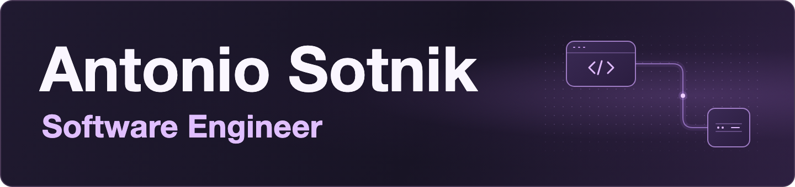
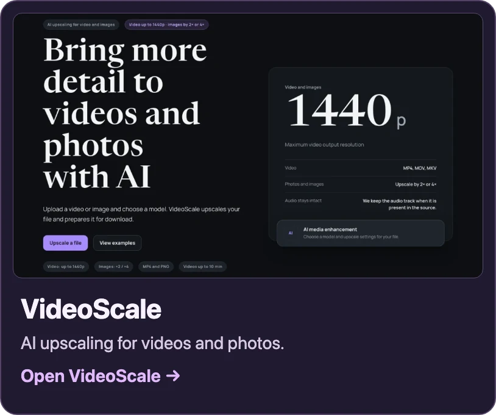
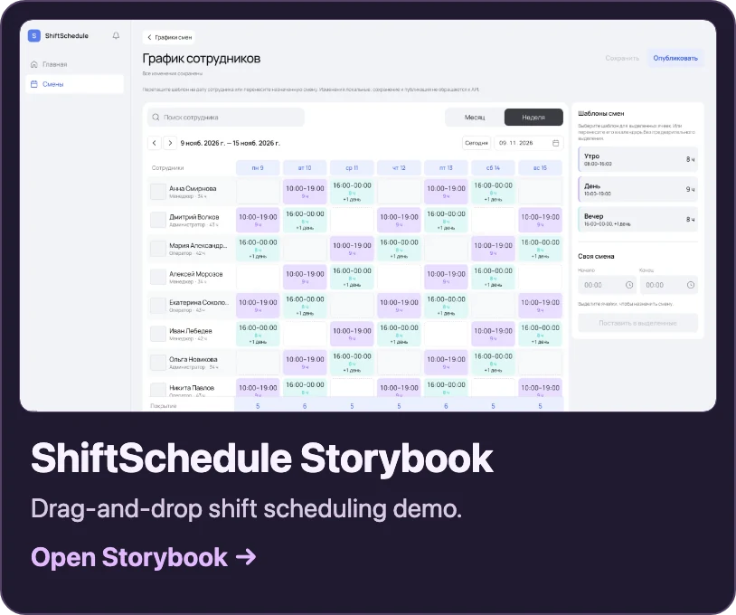

<strong>English</strong> · <a href="https://github.com/Toxanetoxa/Toxanetoxa/blob/main/README.ru.md">Русский</a>

I build web services, from APIs and data processing to user interfaces and design systems.

[Portfolio and experience](https://github.com/Toxanetoxa/AntonioSotnik) · [Telegram](https://t.me/antonioSotnik)

## Featured projects

  
  

### Full Stack

- **[ShiftSchedule](https://toxanetoxa.github.io/ShiftSchedule.frontend/)** — a shift planner with an employee calendar, overlap detection, and schedule publishing. [Vue 3 and TypeScript frontend](https://github.com/Toxanetoxa/ShiftSchedule.frontend) and [Laravel and PostgreSQL API](https://github.com/Toxanetoxa/ShiftSchedule.backend).

### Frontend

- **[LOW GAME](https://toxanetoxa.github.io/low-game/)** — a two-player browser fighting game built with TypeScript and WebRTC. [Source code](https://github.com/Toxanetoxa/low-game).

### Backend

- **[Workout Tracker API](https://github.com/Toxanetoxa/workout-tracker)** — workout logging and exercise statistics. Go · PostgreSQL.
- **[Dating Backend](https://github.com/Toxanetoxa/dating-backend)** — an API for a dating app with WebSocket chat. Go · PostGIS · Redis.
- **[Selesa Slots](https://github.com/Toxanetoxa/selesa-slots)** — a gaming wallet service with REST, gRPC, and real-time events over WebSocket.
- **[Notification Preferences Service](https://github.com/Toxanetoxa/notification_preference_service)** — an API for user notification preferences and quiet hours. TypeScript · Fastify · PostgreSQL.

## Technology stack

  <strong>Languages</strong> 
  
  
  
  
  

  <strong>Frontend</strong> 
  
  
  
  
  

  <strong>Frontend tools</strong> 
  
  
  

  <strong>Markup and templates</strong> 
  
  
  
  
  

  <strong>Backend</strong> 
  
  
  
  
  

  <strong>Databases and caching</strong> 
  
  
  
  
  

  <strong>Infrastructure and messaging</strong> 
  
  
  
  
  

  <strong>Releases and monitoring</strong> 
  
  
  
  

