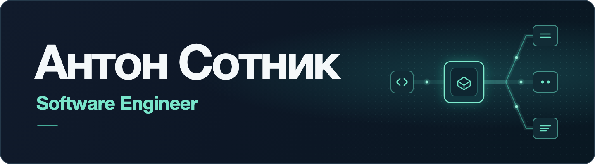
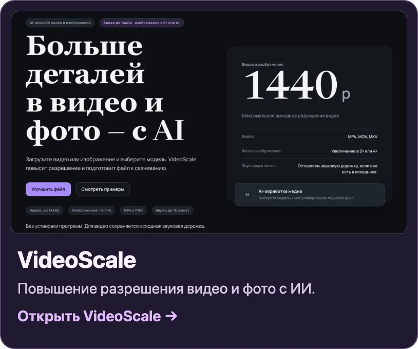
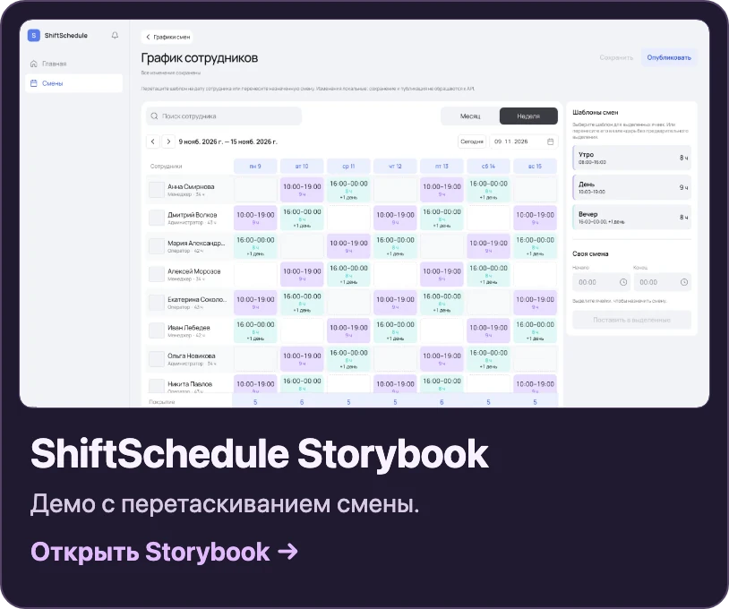
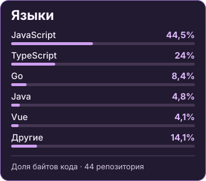
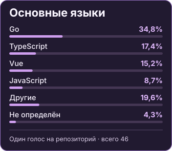
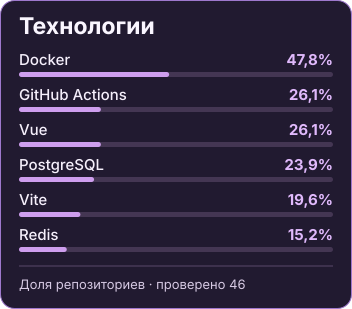
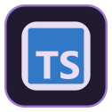
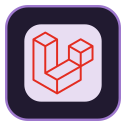

<a href="https://github.com/Toxanetoxa">English</a> · <strong>Русский</strong>

Разрабатываю веб-сервисы от API и обработки данных до интерфейсов и дизайн-систем.

[Портфолио и опыт](https://github.com/Toxanetoxa/AntonioSotnik) · [Telegram](https://t.me/antonioSotnik)

## Избранные проекты

  
  

### Full Stack

- **[ShiftSchedule](https://toxanetoxa.github.io/ShiftSchedule.frontend/)** — планировщик смен с календарём сотрудников, проверкой пересечений и публикацией графика. [Vue 3 и TypeScript на клиенте](https://github.com/Toxanetoxa/ShiftSchedule.frontend), [Laravel и PostgreSQL в API](https://github.com/Toxanetoxa/ShiftSchedule.backend).

### Frontend

- **[LOW GAME](https://toxanetoxa.github.io/low-game/)** — браузерный файтинг для двух игроков на TypeScript и WebRTC. [Исходный код](https://github.com/Toxanetoxa/low-game).

### Backend

- **[Workout Tracker API](https://github.com/Toxanetoxa/workout-tracker)** — учёт тренировок и статистика по упражнениям. Go · PostgreSQL.
- **[Dating Backend](https://github.com/Toxanetoxa/dating-backend)** — API приложения знакомств с чатом на WebSocket. Go · PostGIS · Redis.
- **[Selesa Slots](https://github.com/Toxanetoxa/selesa-slots)** — сервис игрового кошелька с REST, gRPC и событиями по WebSocket.
- **[Notification Preferences Service](https://github.com/Toxanetoxa/notification_preference_service)** — API пользовательских настроек уведомлений и тихих часов. TypeScript · Fastify · PostgreSQL.

## Аналитика репозиториев

  
  
  

В выборку входят мои публичные репозитории за исключением форков, архивных проектов и этого профиля. На графике основных языков у каждого репозитория один голос. Язык определяет GitHub, а проекты без определённого языка учитываются отдельно. График по объёму кода построен на данных GitHub Linguist, поэтому на график сильнее влияют крупные репозитории, например [Nizhny-Novgorod-map](https://github.com/Toxanetoxa/Nizhny-Novgorod-map). Доли технологий рассчитаны по зависимостям и файлам конфигурации. Один репозиторий может учитываться в нескольких долях.

## Технологии

  <strong>Языки</strong> 
  
  
  
  
  

  <strong>Frontend</strong> 
  
  
  
  
  

  <strong>Инструменты фронтенда</strong> 
  
  
  

  <strong>Вёрстка и шаблоны</strong> 
  
  
  
  
  

  <strong>Backend</strong> 
  
  
  
  
  

  <strong>Базы данных и кеши</strong> 
  
  
  
  
  

  <strong>Инфраструктура и очереди</strong> 
  
  
  
  
  

  <strong>Релизы и мониторинг</strong> 
  
  
  
  

